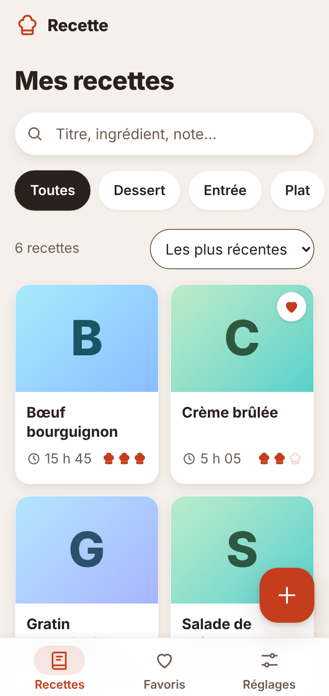
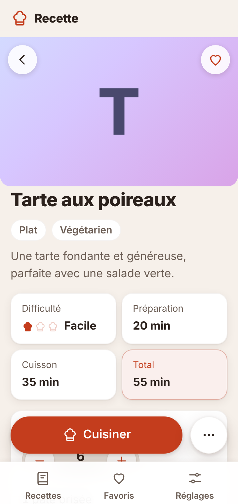
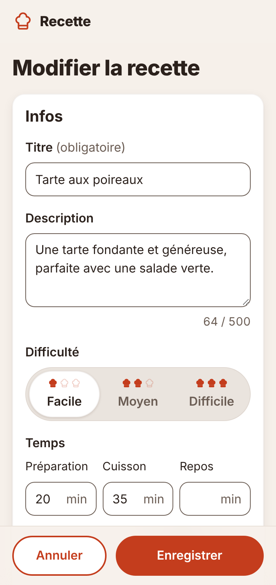
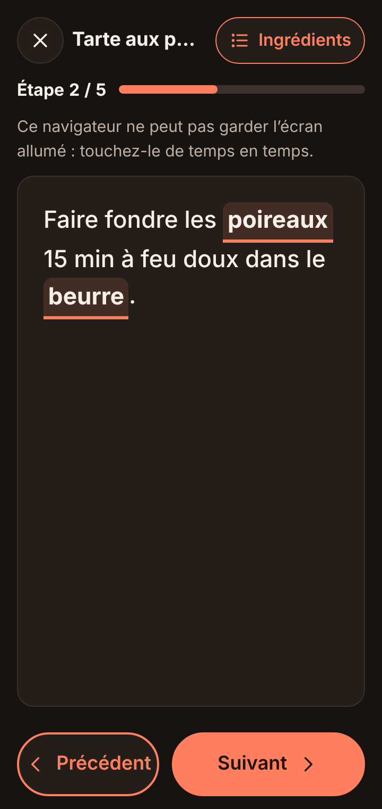
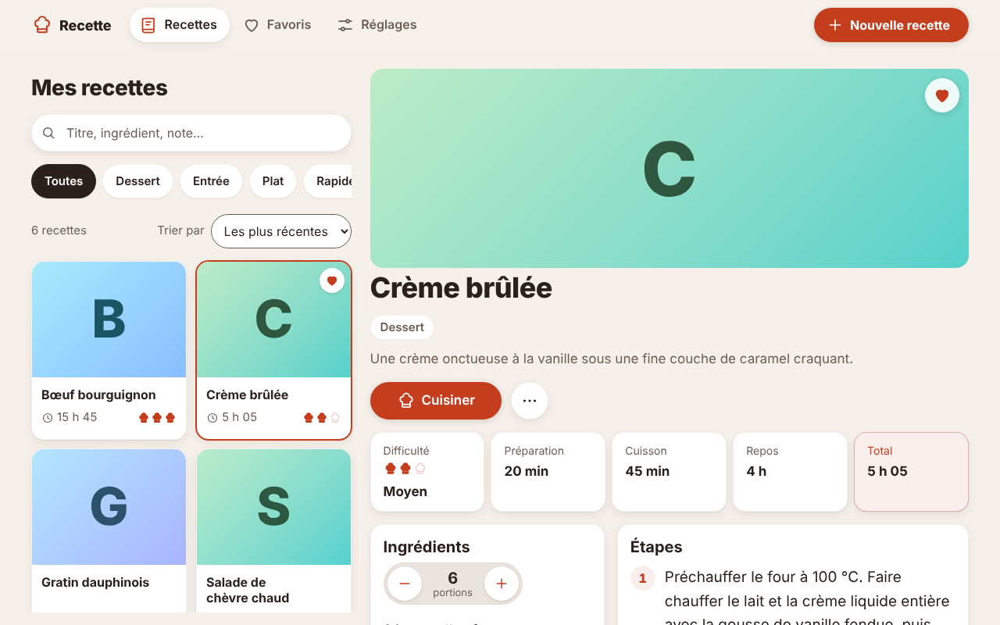

# Recette

Application web pour créer, ranger et cuisiner ses recettes, inspirée de Croûton.
Pensée d'abord pour le téléphone, elle fonctionne hors ligne et s'installe sur l'écran d'accueil (PWA).
Sans compte ni abonnement : les recettes restent sur l'appareil.

**Ouvrir l'app : <https://pierrecyrildecrock.github.io/Recette/>**

| Liste | Fiche | Formulaire | Mode cuisine (sombre) |
| --- | --- | --- | --- |
|  |  |  |  |

Sur grand écran, la liste et la fiche s'affichent côte à côte :



## Fonctionnalités (version 1.0, MVP)

- **Recettes** : créer, modifier, dupliquer, supprimer ; titre, description, difficulté (en toques),
  temps de préparation, cuisson et repos, portions, catégories, ingrédients, étapes, notes et source.
- **Saisie rapide** : un ingrédient s'écrit sur une ligne (« 250 g de farine »), Entrée passe à la
  ligne suivante, un collage de plusieurs lignes crée autant d'ingrédients ou d'étapes ; lignes
  réordonnables au doigt ou au clavier ; brouillon gardé en cas de fermeture.
- **Liste** : recherche instantanée dans les titres, ingrédients et notes (sans tenir compte des
  accents ni des majuscules), filtre par catégorie, tri, favoris.
- **Fiche** : portions ajustables (quantités recalculées et arrondies lisiblement), partage.
- **Mode cuisine** : une étape à la fois, en grand ; balayage, flèches ou boutons ; ingrédients
  cités cliquables avec leur quantité ; écran maintenu allumé.
- **Hors ligne et installable** : tout fonctionne sans réseau après la première visite ; une
  mise à jour est proposée par un bandeau « Recharger ».
- **Données** : stockées sur l'appareil (IndexedDB), export et import JSON, effacement complet.
- **Confort** : thèmes clair et sombre (ou système), de 320 à 1440 px, accessible au clavier et
  aux lecteurs d'écran (WCAG 2.2 AA), mouvements coupés si l'appareil le demande.

## Qualité

| Mesure | Résultat (version 1.0.0) | Exigence |
| --- | --- | --- |
| Lighthouse mobile | Performance 100 · Accessibilité 100 · Bonnes pratiques 100 · SEO 100 | ≥ 90 · ≥ 95 |
| Lighthouse bureau | 100 · 100 · 100 · 100 | — |
| JavaScript compressé (gzip) | 86,7 Ko (`npm run budget`) | < 100 Ko |
| Recherche sur 500 recettes, affichage compris | 10 à 41 ms dans le navigateur (Chromium) | < 100 ms |
| axe-core, 16 écrans et états × 2 thèmes × mobile et bureau | 0 violation, toutes gravités confondues | 0 sérieuse ou critique |
| Tests | 167 unitaires, 182 de bout en bout (mobile Pixel 7 et bureau) | tous verts |

Les critères de recette du MVP et ce qui reste à vérifier sur un vrai téléphone (saisie en moins
de 3 minutes, redémarrage du téléphone, écran allumé 10 minutes) sont détaillés dans le
[cahier des charges](docs/cahier-des-charges.md#planning-et-critères-de-recette).

## Lancer en local

Prérequis : Node.js 22 ou plus récent.

```sh
npm install           # outils de développement (tests)
npm run serve         # puis ouvrir http://localhost:8000
npm test              # tests unitaires
npm run e2e           # tests de bout en bout (Playwright)
npm run budget        # poids du JavaScript compressé
npm run verifier-cache  # liste des fichiers mis en cache par le service worker
```

Sans Node : `python3 -m http.server 8000` à la racine du projet suffit pour servir l'app.
Sans framework ni étape de build : les fichiers sont servis tels quels.

## Mise en ligne

Chaque poussée sur `master` lance [`.github/workflows/pages.yml`](.github/workflows/pages.yml) :
tests unitaires, liste du cache, budget, tests de bout en bout, puis publication sur GitHub Pages
de la racine du dépôt (sans `tests/`, `docs/`, `scripts/`, `node_modules/` ni les fichiers de
configuration). Prérequis, une fois : *Settings → Pages → Source : GitHub Actions*.
Changer `VERSION` dans `js/app.js` et `sw.js` à chaque publication.

## Feuille de route

| Lot | Contenu |
| --- | --- |
| 1 — MVP ✅ | Créer, modifier, dupliquer et supprimer des recettes ; recherche ; catégories ; favoris ; portions ajustables ; mode cuisine étape par étape ; hors ligne ; mode sombre ; export / import JSON |
| 2 — Confort | Minuteurs, photos, cases à cocher, sections d'ingrédients, impression, couleur d'accent |
| 3 — Organisation | Liste de courses, planning de la semaine |
| 4 — Avancé | Partage par lien, import depuis une URL, synchronisation entre appareils |

Détails : [cahier des charges](docs/cahier-des-charges.md) · [plan de développement](docs/plan-de-developpement.md).
